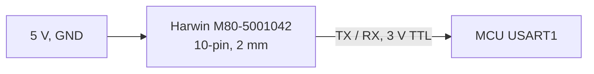

# VN-100 Rugged interfaces

| Item | Value | Source |
|---|---|---|
| Supply | 4.5-5.5 V, about 0.22 W, from the 5 V buck (W28, W29) | `catalog/power_electronics.json`; docs/body-electrical.md |
| Connector | Harwin Datamate J-Tek M80-5001042, 10-pin, 2 mm pitch, on the -X end with jack screws | `catalog/power_electronics.json` |
| Serial | TTL (the 3 V port) or RS-232; the robot uses TTL to USART1 (PA9 TX to the sensor's RX, PA10 RX) | docs/body-firmware.md 6 |
| Link | 115200 baud out of the box, then 921600 set at every boot | `firmware/balance/src/mcu/board.c` |
| Output | binary group 1 (yaw, pitch, roll and the three rates), 30 bytes at 800 Hz, CRC-16-CCITT | `include/gp/gp_vn100.h` |
| Mounting | 2 x 3.18 mm holes (4-40 or M3) 30.84 mm apart, 2 x 1.59 mm dowel holes; flat and rigid | `catalog/power_electronics.json` |
| Size, mass | 33.1 x 35.9 x 8.9 mm, 15 g | drawing VN-100-CR-ASM rev 7.0.0 |
| Axes | x forward, y right, z down when mounted so (assumed); the firmware turns them into x forward, y left, z up | `include/gp/gp_vn100.h` |
