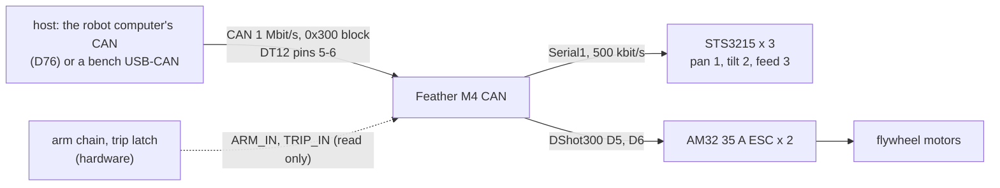

# Turret electronics (Feather M4 CAN controller)

The turret's own electronics: an Adafruit Feather M4 CAN Express runs the pan, tilt and feed servos, the two flywheel
ESCs, the chronograph and the laser, behind a hardware arm chain, and talks to its host over CAN in the 0x300 block.
The full design is the turret's own docs ([turret firmware](../../../docs/turret-firmware.md),
[turret wiring](../../../docs/turret-wiring.md)); this folder is its entry in the hardware map. **Nothing for the turret
is recorded as bought except its flywheel motor** (`docs/purchases.md`, [docs/ordered-turret-motor.md](../../../docs/ordered-turret-motor.md)).

**Coordination:** [PR #196](https://github.com/Valpatel/gyropup/pull/196) (D76) takes the turret's computer off (the
J501's can1 commands it; the Feather stays). This folder follows dev and does not edit that PR's files; it moves to
D76's wording when #196 merges.

## References

- [references/vendor/feetech-sts3215/](../../../references/vendor/feetech-sts3215/) (the servos); the other parts' sources are in
  `catalog/turret.json`.
- The flywheel motor in hand, unmeasured: [docs/ordered-turret-motor.md](../../../docs/ordered-turret-motor.md).

## Interfaces

The Feather's pins, the CAN segment and its messages: [interfaces.md](interfaces.md).

## Config and profiles

Not yet in this folder: the turret's CONFIG messages (0x304: the depression table, keep-outs, the mount, the throttle
map) carry its settings at start ([turret firmware](../../../docs/turret-firmware.md) section 6); `can_msgs.py` is their
definition.

## Driver

The turret's firmware and host code, described in [docs/turret-firmware.md](../../../docs/turret-firmware.md); the boards'
layout check is `cad/turret_boards.py`.

## Inventory

[`inventory.json`](inventory.json): none in hand.

## Bring-up and tests

The turret's own plans: [docs/turret-firmware.md](../../../docs/turret-firmware.md) and
[docs/turret-wiring.md](../../../docs/turret-wiring.md).

## Open questions

- The host: the robot computer's CAN port (D76, PR #196) or the turret's own computer (D66, on dev).
- The flywheel motor: the catalog uses a SunnySky X2216 1400KV, the firmware page still says 880 KV, and the motor
  ordered is the Deeahdah 3115-900KV, its fit unmeasured.
