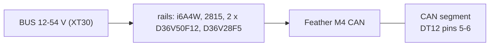

# Turret controller interfaces

| Item | Value | Source |
|---|---|---|
| Controller | Adafruit Feather M4 CAN Express (product 4759), its on-board transceiver and 120 ohm | `catalog/turret.json`; docs/turret-wiring.md |
| CAN | its own segment, 1 Mbit/s classic, the turret and its host only, the 0x300 block, little-endian | docs/turret-firmware.md 6 |
| Heartbeats | host 0x300 at 10 Hz (older than 200 ms: no arm); turret 0x310 at 10 Hz | docs/turret-firmware.md 6 |
| Servos | 3 x Feetech STS3215 on Serial1 (D0 / D1), half-duplex at 500 kbit/s: ids 1 pan, 2 tilt, 3 feed | docs/turret-firmware.md 1 |
| ESCs | 2 x Repeat Robotics AM32 35 A on D5, D6, bidirectional DShot300 | docs/turret-firmware.md 1; `catalog/turret.json` |
| Safety inputs | ARM_IN (D12) and TRIP_IN (A1) read only through 100 k; the arm chain is hardware | docs/turret-firmware.md 1 |
| Supply sense | BUS_V on A0 through 182 k / 10 k; it picks the supply profile (D70) | docs/turret-firmware.md 1 |
| Power in | the XT30 from the robot's stop relay pole B (W34, MINI 58V 7.5 A) | docs/body-electrical.md, wiring table |
