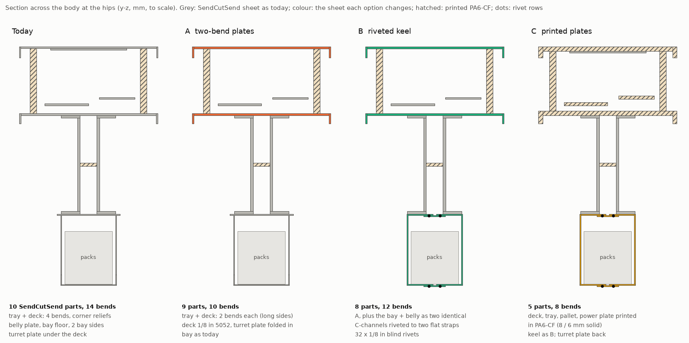
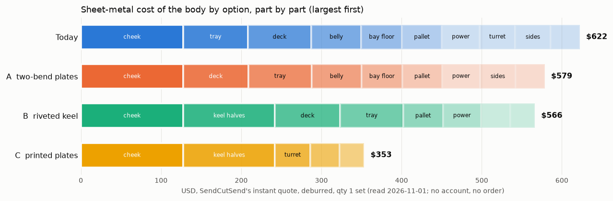
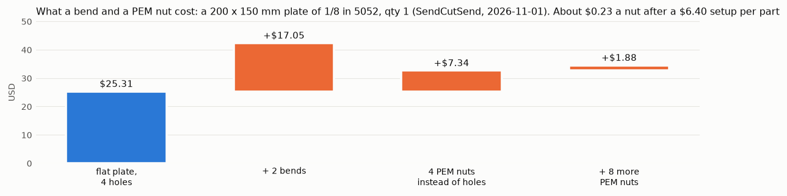
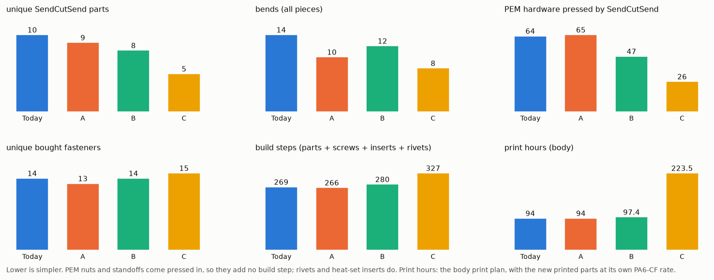
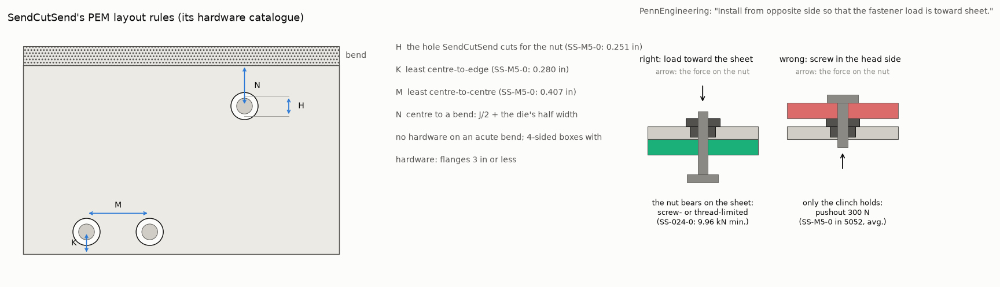
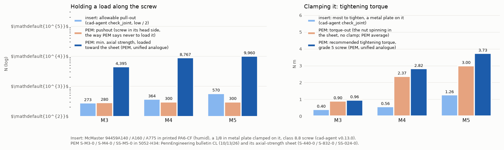

# Body sheet metal: fewer, simpler SendCutSend plates (study, issue #155)

The owner asked for SendCutSend bent sheet that is affordable and easy to build: few parts, printing where it can
carry the load, simple plates with two bends at most and PEM hardware pressed in by SendCutSend, and riveted assemblies
of simple bent parts where a box needs more. This study prices today's body and three alternatives, checks them with
cad-agent v0.13.0 and runs the body plan's FEA cases on each. **D75** in `docs/decisions.yaml` is the proposal; the
choice is the owner's. Nothing in `cad/` or `catalog/` changes here.

## The comparison

| | Today | **A** two-bend plates | B riveted keel | C printed plates |
|---|---|---|---|---|
| SendCutSend metal, qty 1 set | $622 | **$579** | $566 | $353 |
| + printed material, rivets (estimate) | $58 | **$58** | $67 | $221 |
| Unique SendCutSend parts / pieces | 10 / 13 | **9 / 12** | 8 / 12 | 5 / 9 |
| Bends (all pieces) / most on one part | 14 / 4 | **10 / 2** | 12 / 2 | 8 / 2 |
| PEM hardware pressed by SendCutSend | 64 | **65** | 47 | 26 |
| Unique bought fasteners | 14 | **13** | 14 (+ rivet) | 15 |
| Frame mass: sheet + printed | 4.68 kg | **4.61 kg** | 4.86 kg | 5.06 kg |
| Strength and stiffness (FEA, below) | passes | FEA_A | FEA_B | FEA_C |
| Build steps: parts + screws + inserts + rivets | 269 | **266** | 280 | 327 |
| Print hours (body) | 94 | **94** | 97 | 224 |

Cost is SendCutSend's instant quote for one set, deburred, read 2026-11-01 (no account, no cart, no order). Printed
material is at the body print plan's own filament price; rivets at an estimated $0.12 each (not quoted). The masses
are the CAD solids at each material's density. `study.json` has every row, part by part.

## Where the money is

A part costs its setup before it costs its metal. A 200 × 150 mm plate of 1/8 in 5052 is $25.31 flat. Two bends add
$17.05. Four PEM nuts add $7.34, and eight more add only $1.88: about $0.24 a nut after a $6.40 setup per part. So
cutting a part or a bend saves money; adding PEM nuts to a part that already has some costs almost nothing.

- **The box is already the owner's pattern.** Today's body is SendCutSend plates with 64 PEM nuts and standoffs; the
  printed posts, riser and cassettes carry the rest. The cheeks (3/16 in, $128 the pair) are the largest line and the
  hip-to-hip load path: S1F's fault case leaves them at SF 1.34 against 1.2, so they stay.
- **Fewer bends and parts are the lever.** A drops four bends and the turret plate: −$44. B also merges the belly
  plate, bay floor and bay sides into two identical riveted C-channels: −$12 more, but +199 g and 32 rivets to pull.
- **Printing the plates (C) saves $269 of metal and spends $158 of PA6-CF, 130 print hours and 0.38 kg.**

## Strength and stiffness

FEA_SECTION

## PEM nuts against heat-set inserts

A PEM nut is stronger than a heat-set insert only when it is loaded the way PennEngineering says to load it: the screw
enters from the side opposite the nut's head, so the load pulls the nut into the sheet. Loaded that way, the nut's
thread or the screw fails first: about 10 kN for the M5 size. Its pushout (300 N) and torque-out (3.0 N·m) are what the
clinch holds while it is handled and while the screw is first turned. PennEngineering's bulletin says: "DON'T install
screw in the head side of fastener. Install from opposite side so that the fastener load is toward sheet."

Thread by thread, the PEM in 5052 beside cad-agent's `check_joint` for the heat-set insert in printed PA6-CF (humid),
with a 1/8 in metal plate clamped on it and a class 8.8 screw:

| Thread | Insert: allowable pull-out (low / 2) | Insert: most to tighten | PEM: pushout, head-side load | PEM: min. axial, load toward the sheet | PEM: recommended tightening |
|---|---|---|---|---|---|
| M3 | 273 N | 0.40 N·m | 280 N | 4,395 N | 0.96 N·m |
| M4 | 364 N | 0.56 N·m | 300 N | 8,767 N | 2.82 N·m |
| M5 | 570 N | 1.26 N·m | 300 N | 9,960 N | 3.73 N·m |

The insert's figures are cad-agent's (v0.13.0, `cadagent.mechanical.inserts.check_joint`). The PEM's come straight from
PennEngineering: bulletin CL (dated 10/13/26) for pushout and torque-out in 5052-H34 (averages), and its "Axial
Strength and Mating Screw Recommended Tightening Torque" sheet (updated 10/28/21), which lists unified sizes only, so
S-440-0, S-832-0 and SS-024-0 stand in for M3, M4 and M5.

**Each PEM joint in the body against its load** (the body plan's landing at 8.51 g and the leg's S1F fault):

| Joint | PEM | Load per nut | Loaded toward the sheet? | Against |
|---|---|---|---|---|
| Hip frame to cheek (proposed: the nut for D74's sleeved M5 through-bolt) | SS-M5-0, 6 a cheek | 851 N fault tension | yes: the head in the spine's gap, the frame on the flush face | 9.96 kN min. axial: × 11.7. Today's insert: 570 N allowable, so D74 already replaces it |
| Tray and belly to the cheeks' flanges | SS-M5-0, 8 a cheek | ~475 N shear (S1F couple), ~40 N tension | yes (pressed from the flanges' inner side) | friction under a 3.7 N·m clamp (≈3.9 kN): × 2.4 in shear |
| Pack adapter plates to the belly or keel | S-M4-0, 4 a pack | 33 N | yes (screws up from below) | 300 N pushout even reversed: × 9 |
| Compute pallet isolator studs, tray | S-M4-0, 4 | 29 N | either | 300 N pushout: × 10 |
| Power plate: VESCs, shunt, switch, MCU | F-M5-2, F-M4-2 | under 10 N | either | × 30 or more |
| Fan duct tabs, deck (A) | S-M3-0, 3 | grams | either | 280 N pushout |

**Where a PEM replaces something:** the hip frame's sleeved through-bolts (D74) need a nut on the far side of a
31 mm gap. Six SS-M5-0 in each cheek put that nut in the plate: the bolt goes in from the leg's face, nothing is held in
the gap, and the nut cannot turn. Six PEM nuts pass SendCutSend's rules at the cheek's existing holes (Gyropup's sheet
checks) and add about $1.40 a cheek. Tighten to PennEngineering's 3.7 N·m (about 3.9 kN, 4.5× the fault tension), not
the 5.1 N·m the leg plan sets for a loose nut. Heat-set inserts stay in the lightly loaded printed parts: the deck and
power-plate posts, the riser and the bay rails (each under half its allowable pull-out).

## The options

- **A, two-bend plates.** The floor tray and deck keep lips on their two long sides only (two bends, no corner reliefs,
  which removes cad-agent's corner-relief failure on today's tray). The deck goes from 0.100 to 0.125 in 5052 and takes
  the turret plate's job: the riser bolts straight through it, and the fan duct's three tabs become PEM S-M3-0 in it.
  Every M5 button screw becomes one length (M5 × 12). The battery bay stays as today.
- **B, riveted keel.** A, plus the belly plate, the bay floor and both bay sides become two identical 0.090 in 5052
  C-channels (a web and two flanges each) riveted to two identical flat straps with 32 × 1/8 in blind rivets. The
  rivets' IFI-114 minimum is 756 N shear and 979 N tensile; the straps carry the cheeks' tie across the gap, so B is
  judged on the spine cases. The bay rails grow from 10 to 20 mm to keep their screws clear of the top bend.
- **C, printed plates.** B, plus the deck, tray, compute pallet and power plate printed in PA6-CF (8 mm and 6 mm
  solid; the deck and tray in two halves each, joined with M5 screws into inserts). The turret plate comes back.

## Recommendation

RECOMMENDATION

## Owner decisions

OWNER_DECISIONS

## Where each number comes from

| Number | From | How |
|---|---|---|
| Bend radius, K factor, allowance, flat length, least flange, corner relief | cad-agent v0.13.0 | `cadagent.manufacturing.sheet_metal.bend` and `flat_length`, SendCutSend's row where cad-agent's shop table has one (0.063, 0.090, 0.125 in 5052) |
| Manufacturability verdicts | cad-agent v0.13.0 | `cadagent.manufacturing.dfm.check("sheet-metal")` on each bent part's flanges, nearest hole to a bend, smallest hole and corner relief (`study.json` → `checks`) |
| Heat-set insert pull-out, torque-out, tightening | cad-agent v0.13.0 | `cadagent.mechanical.inserts.check_joint` |
| Stiffness and strength | cad-agent v0.13.0 | `cadagent.fea`, through `cad/body_studies.py`'s cases, patched per option by `fea.py` |
| PEM hole, edge, spacing, bend distance, sheet range | SendCutSend, read 2026-11-01 | its hardware catalogue and hardware service pages; cad-agent has no PEM rules yet |
| SendCutSend bend limits (5052 in 8 gauges from 0.040 to 0.250 in, no 6061 bends, features half a die from a bend, flanges ≤ 3 in on boxes with hardware) | SendCutSend, read 2026-11-01 | its CNC bending and hardware pages |
| PEM pushout, torque-out, axial strength, tightening torque | PennEngineering | bulletin CL (10/13/26); axial-strength sheet (10/28/21) |
| Blind rivet strength | IFI-114 (2015) | the minimum ultimate loads as a distributor prints them |
| Prices | SendCutSend's instant quote, 2026-11-01 | `quote.py`, no account and no order (`prices.json`) |

**Gaps found in cad-agent v0.13.0** (to be fixed there through its own PR flow, not in Gyropup; the coordinator reports
the sheet-metal, PEM and rivet work is under way in cad-agent):

1. No PEM or clinch-hardware rules: hole, edge, spacing, bend distance, sheet range, installed side, load direction.
2. The shop table has no 0.100 in or 0.187 in 5052 rows, though SendCutSend bends both; those parts fall back to
   generic rules (the cheek's flange then reads as too short against a generic 33 mm, though SendCutSend takes it).
3. Hole to bend uses the generic 2-2.5 t + R. SendCutSend's own rule is half its die width, so cad-agent fails holes
   that SendCutSend accepts (the tray's power-plate post at 5.9 mm).
4. The smallest hole uses a punching rule (at least t); SendCutSend cuts by laser.
5. No rivet check, and `check_joint` has no clinch-nut model, so this page sets the two side by side by hand.

## Files

- `parts.py`: each option's SendCutSend parts, built from `cad/` functions and changed only here.
- `quote.py` → `prices.json`, `dxf/`: SendCutSend's instant price for every part and the four probe plates.
- `fea.py` → `fea/<option>/summary.json`: the body plan's FEA cases on each option.
- `study.py` → `study.json`: the comparison, checks and joints. `figures.py` → `fig-*.png`.

Rerun: `.venv/bin/python research/body-sheet-metal/study.py && .venv/bin/python research/body-sheet-metal/figures.py`
with cad-agent v0.13.0 on the path. FEA runs on an x86 CAD host: `fea.py --option today|A|B|C`.
