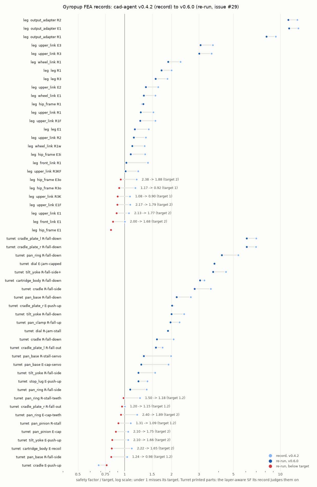

# The FEA records on cad-agent v0.6.0 (issue #29)

cad-agent v0.6.0 changes the material data Gyropup's FEA uses (cad-agent #157). cad-agent #197 projected the effect on
Gyropup from the recorded results without re-running anything. This folder replaces that projection with a re-run:
the leg and turret records were regenerated with v0.6.0 on the host and mesher that made them, and are compared study
by study with what they read before and with #197's projection.

| Row | E (MPa), v0.4.2 → v0.6.0 | Strength (MPa), v0.4.2 → v0.6.0 | SF factor | Deflection factor |
|---|---|---|---|---|
| `pa6_cf_xy` (humid PA6-CF, along the layers) | 3000 → 1029 | 49 → 40.84 | ×0.833 | ×2.91 |
| `pa6_cf_z` (across the layers) | 2400 → 488 | 23 → 18.13 | ×0.788 | ×4.92 |
| `al6061` (6061-T6) | 68900 → 68258 | 276 → 241.3 | ×0.874 | ×1.01 |
| `petg` | 1800 → 1120 | 20 → 20 | ×1 | ×1.61 |

## Results

`comparison.md` has every study: before, #197's projection, after, the stress and deflection ratios, and today's part
under the old data.

| | before (v0.4.2 records) | #197's method on the same records | after (v0.6.0 re-run) |
|---|---|---|---|
| studies below SF 2.0 (of 62 in the materials whose strength changed) | 21 | 28 | **27** |
| studies below SF 1.2 | 4 | 9 | **8** |
| cases below their own target (54 regenerated studies with a target) | 2 | | **16** |

The 62 are the leg (26), the turret (26 of its 28: the two PETG dial studies keep their strength) and the historical
D33 leg (10, scaled; see below). "Below its own target" is each record's verdict: the gate SF against the case's
target, and for the turret's printed parts its layer-aware SF.

**Deflections** grow by the modulus ratio, ×2.91 along the layers and ×4.92 across, wherever the part did not change.
That confirms #197's projection of them. The exceptions are four studies whose peak stress is unchanged but whose
stiffness PR 134 changed: the wheel link's R1 and R1w grow ×2.70, and the hip frame's E3o and R3o ×4.69. The rest are
within 1.3 % of the modulus ratio. Against today's leg on v0.4.2 (`evidence/leg-v042-today.json`), all 26 leg studies
scale exactly. Where the design changed, the ratio is 0.86 to 1.04 of the modulus ratio on the leg, and 0.46 to 2.10
on the turret.

### Studies whose SF crosses 2.0 or 1.2

| Record | Part, case | Material | Target | SF before | SF after | Crosses | Meets its target after |
|---|---|---|---|---|---|---|---|
| leg | upper link E1 | PA6-CF xy | 2.0 | 2.13 | 1.77 | 2.0 | **no** |
| leg | upper link E1F | PA6-CF xy | 2.0 | 2.17 | 1.79 | 2.0 | **no** |
| leg | upper link R3KF | PA6-CF xy | 1.0 | 1.22 | 1.01 | 1.2 | yes |
| leg | front link E1 | PA6-CF xy | 2.0 | 2.00 | 1.68 | 2.0 | **no** |
| leg | hip frame E3o | PA6-CF z | 2.0 | 2.38 | 1.88 | 2.0 | **no** |
| turret | pan base R-fall-side | PA6-CF z | 1.2 | 1.29 | 1.02 | 1.2 | **no** |
| turret | cradle plate (left) R-fall-out | 6061-T6 | 1.2 | 2.10 | 1.90 | 2.0 | yes |
| turret | cradle plate (right) R-fall-out | 6061-T6 | 1.2 | 1.20 | 1.15 | 1.2 | **no** |
| turret | cartridge body R-fall-down | PA6-CF z | 1.2 | 2.08 | 1.67 | 2.0 | yes |
| D33 leg (scaled) | yoke bracket Y1-fall | PA6-CF z | none | 1.25 | 0.98 | 1.2 | (no target) |

On the turret's layer-aware verdict, 11 printed or aluminium cases cross 2.0 or 1.2; they are in `comparison.md`.

### Worst parts

Sixteen cases miss their target after the re-run, against two before. Seven are on the leg (below) and nine on the
turret (in its section). Ranked by SF over target, the furthest below are:

- the turret cradle's E-push-up: 1.53 / 2.0;
- the hip frame's E1: 1.63 / 2.0 at the 4 mm gate mesh, and 1.41 at 3 mm, so not converged;
- the turret pan base's R-fall-side: 0.98 / 1.2;
- the turret cartridge body's E-recoil: 1.65 / 2.0.

Two fault cases now read below 1.0: the upper link's R3K (0.90) and the hip frame's R3o (0.92).

The toolkit's layer check, which the records do not use as their verdict, reads the leg's links much lower. It puts
the front link's R1 at 0.52 / 1.2 and the upper link's R3K at 0.48 / 1.0 (see `Study.layer_check()` below).

**The leg.** Each record's verdict is the gate SF, the von Mises SF in the record's material row. The peak is in each
part's own frame, in mm (`exports/leg/fea/summary.json` `design_peak_at_mm`).

| Part, case | Load case | Material | Target | Before → after | Peak | Moved by |
|---|---|---|---|---|---|---|
| upper link E1 | turn: standing, 2.5 × 184 N vertical and 0.5 g sideways; rear link at −129° | PA6-CF xy | 2.0 | 2.13 → 1.77 | [23.6, 1.2, 20.7] | material |
| upper link E1F | the same; front link at −51° | PA6-CF xy | 2.0 | 2.17 → 1.79 | [27.6, 0.8, −13.7] | material |
| upper link R3K | collapse (rig `power_off`): folded onto the stops, 122 N m on a stop post, 1831 N at the axle | PA6-CF xy | 1.0 | 1.08 → 0.90 | [25.6, 1.0, −17.2] | material |
| front link E1 | turn | PA6-CF xy | 2.0 | 2.00 → 1.68 | [293.5, 51.0, −11.6], the apex | material |
| hip frame E1 | turn: both upper links' pin forces | PA6-CF z | 2.0 | 1.65 → 1.63 (1.41 at 3 mm) | [94.8, −23.4, −58.9] at 4 mm; [120.0, −25.2, 45.0] at 3 mm | material ×0.79; PR 134's frame, stress ×0.80 |
| hip frame E3o | a motor at its cap into a stop: 60 N m, 1038 N on the front motor's knee-out post | PA6-CF z | 2.0 | 2.38 → 1.88 (2.02 at 3 mm) | [112.4, −1.6, 56.7], the stop post's seat | material |
| hip frame R3o | collapse: 122 N m, 2115 N on the front motor's knee-out post | PA6-CF z | 1.0 | 1.17 → 0.92 (0.99 at 3 mm) | [112.4, −1.6, 56.7] | material |

The 3 mm values come from `evidence/hip-frame-v060.json`. At 3 mm the hip frame's E1 peak is somewhere else,
[120.0, −25.2, 45.0]. That is the region where the 4 mm layer check's worst corner also sits ([121.8, −25.1, 47.7]).
So the drop from 1.63 to 1.41 is a second hot spot taking over, not the 4 mm peak refining. The E3o miss rests on
the 4 mm gate alone: it reads 2.02 at 3 mm.

Today's leg under v0.4.2 is in
`evidence/leg-v042-today.json`: the same revision, host and meshes. It passes every target, and its weakest case is
the front link's E1 at 2.02. Its design stress equals the v0.6.0 run's in all 26 studies, so each of the seven leg
cases below target comes from the material change alone. The hip frame's E1 is 2.07 on today's frame under the old
data. The front link's buckling SF goes from 14.47 to 4.96 because it scales with the modulus.

**The leg's joint checks did not take v0.6.0's data.** Three checks in `cad/leg_studies.py` judge printed-part
bearing against Gyropup's own 40 MPa allowable for humid PA6-CF, sustained, in its layers:

- the stop post's pin bearing in the hip frame's web (`PIN_BEARING_MPA`);
- the knee eyes' pressure;
- the hub dowels' bearing.

That 40 MPa was set when the toolkit's humid in-layer strength was 49 MPa. It is now 98 % of v0.6.0's 40.84 MPa.
The record reads these checks unchanged: the joint block of `evidence/leg-v042-today.json` equals the v0.6.0 one.

They pass as recorded. The weakest are:

- the stop post's web bearing in R3, 1.03 / 1.0;
- the rear and front knee eyes in R3, 1.06 and 1.17;
- the knee's 6301-2RS static factor in R3, 1.13 / 1.0, a steel bearing on SKF's C0, which the change does not
  touch.

Derated by the same ×0.833 as the in-layer strength, the stop post's bearing would read 0.86 and the knee eyes 0.88
and 0.97. That is below 1.0. The bearing allowable is the owner's to set, and this PR leaves it as it is.

**Options, for the owner to decide.** Design changes are out of scope here.

- Add material where the peak is:
  - the upper link's knee-end boss root;
  - the front link's apex;
  - the hip frame's two E1 hot spots, at 4 mm and at 3 mm;
  - its stop-post seat.
- Print the part another way, or use another material.
- Cut the load. For R3K and R3o that means less torque on the stops when they fold with power off. For the turret's
  gears it means a lower servo stall cap.
- Change a target, which only the owner can do.
- Measure the allowables. Every SF here rests on data-sheet strengths knocked down for humidity and printing, and a
  printed-coupon test would replace them.

## The turret

All 28 studies were re-run (`exports/turret/fea/`). The turret judges each printed part on a layer-aware SF (its own
check in `cad/turret_studies.py`: tension across the layers against S_z, interlaminar shear against S_z / 2, in-plane
von Mises against S_xy) and each aluminium part on its yield SF.

- **Below target on that verdict: 9 cases, against 1 before** (the cradle's E-push-up). The list is in the table below
  and in `exports/turret/fea/summary.json` `verdict.below_target`.
- **On the isotropic gate SF**, two cases cross a threshold into failure: the pan base's R-fall-side (1.29 → 1.02,
  target 1.2) and the right cradle plate's R-fall-out (1.20 → 1.15, target 1.2). Two more cross 2.0 and still pass
  their 1.2 target: the left cradle plate's R-fall-out (2.10 → 1.90) and the cartridge body's R-fall-down
  (2.08 → 1.67).
- **Eight studies changed design or load after the record was made**, so their stress moved as well as their
  material. The record was made before cf6592e, and the turret has changed since. These are:
  - the cradle's E-push-up: stress ×0.76;
  - the cartridge body's E-recoil (×0.57) and R-fall-down (×0.98);
  - the pan base's two servo cases: ×1.13;
  - the left cradle plate's R-fall-out (×0.97), and the right plate's R-fall-out (×0.91) and E-push-up (×0.88).

  The other turret studies moved by under 0.6 %, and the turret's masses grew by 0.5 %.

The verdict below is the layer-aware SF for printed parts and the yield SF for aluminium. The gate SF is in
`comparison.md`.

| Part, case | Load case | Material | Target | Before → after | Moved by |
|---|---|---|---|---|---|
| tilt yoke E-push-up | 50 N up at the muzzle holds the cradle on the 0° stop: 268 N on the stop sector | PA6-CF xy | 2.0 | 2.10 → 1.66 | material |
| pan ring E-cap-teeth | the pan servo at 50 % of its stall: 112 N on the tooth at the mesh | PA6-CF xy | 2.0 | 2.40 → 1.89 | material |
| pan ring R-stall-teeth | the pan servo at 80 % of its stall: 179 N on the tooth | PA6-CF xy | 1.2 | 1.50 → 1.18 | material |
| pan pinion E-cap | 112 N on one tooth at the pitch line | PA6-CF xy | 2.0 | 2.10 → 1.75 | material |
| pan pinion R-stall | 179 N on one tooth at the pitch line | PA6-CF xy | 1.2 | 1.31 → 1.09 | material |
| pan base R-fall-side | 30 g sideways: 384 N at the bearing seat and 30.5 N m; the housing tube bends across its layers | PA6-CF z | 1.2 | 1.24 → 0.98 | material |
| cradle E-push-up | 50 N up at the muzzle: 88 N up at the CT thumbscrew, 38 N down on the rails' rear cross bar | PA6-CF xy | 2.0 | 1.36 → 1.53 | design (stress ×0.76) and material; below target before too |
| cradle plate (right) R-fall-out | 30 g sideways: the cartridge's 188 N out of the plate's plane | 6061-T6 | 1.2 | 1.20 → 1.15 | material ×0.87, design ×0.91 |
| cartridge body E-recoil | a shot at 105 fps: 79 N squeezing each tyre apart, 105 N of recoil | PA6-CF z | 2.0 | 2.22 → 1.65 | design and material |

## `Study.layer_check()` on the printed parts

v0.6.0 adds `Study.layer_check(normal, ...)`. It resolves each element corner's stress on the layer plane and takes
two checks. The bond check is `sqrt((max(σn, 0) / S_z)² + (τn / S_s)²)`. The bulk check is von Mises over S_xy. The
SF is 1 over the larger. `research/fea-v060-29/layer_check.py` runs it after every printed part's solve, on the same
judged elements the record uses. Each part takes the layer normal its print files use:

- **Leg:** every printed part is turned about x by ±90° onto the bed (`cad/build_leg.py` `ROT`), so n = y.
- **Turret:** the print rotation in `cad/turret.py` `MADE`, which the print STLs are exported with
  (`turret_studies.layer_normal`).

**The interlayer shear allowable is an assumption.** No filament data sheet gives one. The toolkit takes
S_s = S_z / √3 (10.47 MPa for humid PA6-CF). The turret's own check takes S_z / 2 (9.07 MPa). Both are reported
(`evidence/*-layer-check.json`, `shear_half_sz`), and neither is measured: a coupon test of the interlayer shear
strength would replace both.

**Governs** here means that the check reads lower than the SF the record judges the part on: the gate SF on the
leg, and the layer-aware verdict on the turret's printed parts. The evidence files' `layer_check_governs` field
compares with the gate SF. It is the same thing on the leg, and on the turret it is true for 15 studies.

**Leg: governs on 17 of 20 printed-part studies.** Fifteen read below target on it, against 7 on the gate
(`evidence/leg-layer-check.json`). The record judges the links on the in-layer strength (`pa6_cf_xy`). Their worst
corners sit where a boss whose axis runs along y, across the layers, meets the web. On the upper link that is the
knee-end boss at x ≈ 130 mm. On the front link it is the apex at [293.5, 48.0, −11.6], and on the wheel link
[222.8, 54.0, 16.8]. There the stress opens the layers (σn, up to 25 MPa against S_z 18.1) and shears them (τ). The
last columns show how much rests on the shear assumption. "Opening stress alone" is S_z / σn at that corner, an
upper bound on a tension-only check that needs no shear allowable at all. On that alone, four are below 1.0: the
front link's R1 (0.72) and E1 (0.99), the wheel link's R1w (0.89) and the upper link's R1F (0.95). Where σn is compressive (the upper link's
R3K, R3KF, R2 and E2), the result rests on the assumed shear allowable alone.

| Study | Target | Gate SF (record) | layer_check, S_s = S_z/√3 | at S_s = S_z/2 | σn, τ at the worst corner (MPa) | Opening stress alone | Governs | Meets target |
|---|---|---|---|---|---|---|---|---|
| upper link R1 | 1.2 | 1.52 | **0.69** | 0.62 | 17.1, 11.6 | 1.06 | yes | **no** |
| upper link R1F | 1.2 | 1.51 | **0.66** | 0.61 | 19.1, 11.4 | 0.95 | yes | **no** |
| upper link E1 | 2 | 1.77 | **0.77** | 0.7 | 14.7, 10.7 | 1.24 | yes | **no** |
| upper link E1F | 2 | 1.79 | **0.77** | 0.71 | 16.2, 9.8 | 1.12 | yes | **no** |
| upper link R3K | 1 | 0.9 | **0.48** | 0.42 | -21.4, 21.8 | compressive | yes | **no** |
| upper link R3KF | 1 | 1.01 | **0.53** | 0.46 | -16.9, 19.6 | compressive | yes | **no** |
| upper link R2 | 1.2 | 1.37 | **0.8** | 0.69 | -2.3, 13.1 | compressive | yes | **no** |
| upper link E2 | 2 | 2.73 | **1.6** | 1.39 | -1.1, 6.5 | compressive | yes | **no** |
| upper link E3 | 2 | 6.13 | **2.58** | 2.46 | 5.9, 2.2 | 3.09 | yes | yes |
| upper link R3 | 1 | 3.01 | **1.27** | 1.21 | 11.9, 4.6 | 1.52 | yes | yes |
| front link R1 | 1.2 | 1.23 | **0.52** | 0.48 | 25.3, 13.8 | 0.72 | yes | **no** |
| front link E1 | 2 | 1.68 | **0.71** | 0.66 | 18.4, 10.3 | 0.99 | yes | **no** |
| wheel link R1 | 1.2 | 2.28 | **1.2** | 1.13 | 12.0, 5.3 | 1.51 | yes | yes |
| wheel link R1w | 1.2 | 1.34 | **0.7** | 0.67 | 20.5, 9.0 | 0.89 | yes | **no** |
| wheel link E1 | 2 | 2.65 | **1.44** | 1.28 | 5.7, 6.5 | 3.19 | yes | **no** |
| hip frame R1 | 1.2 | 1.58 | **1.32** | 1.22 | 9.9, 5.5 | 1.84 | yes | yes |
| hip frame E1 | 2 | 1.63 | **1.39** | 1.28 | 9.3, 5.3 | 1.96 | yes | **no** |
| hip frame E3o | 2 | 1.88 | **1.89** | 1.8 | 8.0, 3.0 | 2.26 | no | **no** |
| hip frame E3i | 2 | 2.18 | **3.2** | 2.77 | -4.7, 3.3 | compressive | no | yes |
| hip frame R3o | 1 | 0.92 | **0.93** | 0.88 | 16.3, 6.2 | 1.11 | no | **no** |

The hip frame is already judged on the across-layer strength (`pa6_cf_z`), so the check barely moves it. It is lower
only in R1 and E1, at 1.32 and 1.39.

**Turret: governs on 10 of 21 printed-part studies** (`evidence/turret-layer-check.json`). It reads lower than the
isotropic gate on 15. The turret's own layer-aware verdict follows the same idea, so the two mostly agree. The
check adds one case below target, the pan ring's R-fall-side at 1.16 / 1.2 (verdict 1.30). It passes the pan pinion's two cases, which the verdict fails. The difference is the in-layer check. At the tooth
root the verdict takes the von Mises of the in-layer stresses alone (23.4 MPa in E-cap). The toolkit takes the full
von Mises (20.4 MPa), which is lower there because the layers are also squeezed (σn −7.6 MPa).
The PETG dial passes both. The rows below are those where it reads lower than the verdict or below target:

| Study | Target | Gate SF | Verdict (layer-aware) | layer_check (governed by) | at S_s = S_z/2 | Meets target |
|---|---|---|---|---|---|---|
| tilt yoke R-fall-side+ | 1.2 | 4.67 | 4.44 | **3.92** (bond) | 3.63 | yes |
| tilt yoke E-push-up | 2 | 2.07 | 1.66 | **1.56** (bond) | 1.43 | **no** |
| pan ring R-fall-side | 1.2 | 1.42 | 1.3 | **1.16** (bond) | 1.12 | **no** |
| pan ring E-cap-teeth | 2 | 2.61 | 1.89 | **1.86** (bond) | 1.85 | **no** |
| pan ring R-stall-teeth | 1.2 | 1.63 | 1.18 | **1.16** (bond) | 1.16 | **no** |
| pan base R-fall-side | 1.2 | 1.02 | 0.98 | **0.89** (bond) | 0.86 | **no** |
| cradle R-fall-side | 1.2 | 5.17 | 3.38 | **3.27** (bond) | 3.23 | yes |
| cradle E-push-up | 2 | 2.29 | 1.53 | **1.77** (bond) | 1.53 | **no** |
| cartridge body E-recoil | 2 | 1.83 | 1.65 | **1.6** (bond) | 1.59 | **no** |
| dial E-jam-capped | 2 | 5.77 | 7.55 | **7.1** (bulk) | 7.1 | yes |
| dial R-jam-stall | 1.2 | 1.73 | 2.27 | **2.13** (bulk) | 2.13 | yes |

This is a screening check of the isotropic solve, not a qualification. An anisotropic part carries its load
differently, and the walls, seams and infill are not modelled. The worst values sit at element corners at re-entrant
edges, where a finer mesh moves them. A printed part under the case's load would settle it.

## The historical D33 leg record (`exports/fea/`)

It is not regenerated. `cad/studies.py`'s inputs (`cad/gmi.py`, `designs/default.json`, `exports/sim/default`, which
was not yet tracked when the record was made at 4f7bea4) have changed since, so a re-run today is a different design.
Run at d794466 with v0.6.0, every study's stress differs from the record (ratio 0.38 to 2.62;
`evidence/historical-leg-rerun.json`). The record stays as the historical result it is.

Its v0.6.0 values are still exact. `cad/studies.py`, run at one revision under v0.4.2 and v0.6.0 on the same host,
gives the same meshes and the same design stress in all 10 studies. Only the SF moves, by the strength ratio, and the
deflection, by the modulus ratio (`evidence/historical-scaling-control.json`). So `comparison.md` lists the record's
v0.6.0 SF as the new strength over its recorded design stress, marked "scaled". The yoke bracket's Y1-fall drops from
1.25 to 0.98 (no target in that record).

## cad-agent #197's projection

#197 multiplied each recorded SF by the strength ratio and each deflection by the modulus ratio. It read the
records at a79e48c, which is older than dev's records: the turret record there has 22 studies on an earlier design,
and cf6592e replaced it with 28. That is why #197 counted 56 studies, with 26 → 33 below 2.0 and 8 → 12 below 1.2.
`compare.py` reproduces those numbers exactly from a79e48c.

| | before | #197's method on dev's records | re-run |
|---|---|---|---|
| below SF 2.0 (62 studies) | 21 | 28 | 27 |
| below SF 1.2 | 4 | 9 | 8 |

- **The method is right where the part did not change.** In the 29 regenerated studies with no change of design or
  load, the re-run SF is within 0.03 of the projection, which is rounding. The deflections grow by ×2.91 and ×4.92 as
  projected, except four leg studies whose stiffness PR 134 changed (see Results). That holds because each study is one linear material under force loads: the stress does not depend on
  E. The two control runs show it (`evidence/historical-scaling-control.json`; the leg on both toolkits at one
  revision, `evidence/leg-v042-today.json`).
- **It is wrong where the part changed after its record**, because a projection cannot see that:
  - the turret's cradle E-push-up: projected 1.73, re-run 2.29, stress ×0.76;
  - the cartridge body's E-recoil: projected 1.03, re-run 1.83, stress ×0.57;
  - the hip frame after PR 134: E1 projected 1.30, re-run 1.63;
  - the front link after PR 134: R1 projected 1.41, re-run 1.23, a thinner apex wall, stress ×1.15.

  The first two are the one-study differences in each count.
- **It counts the gate SF, not each record's verdict.** On the verdicts, 16 cases are below target after the re-run,
  against 2 before. Twelve of the 14 new ones are the material change alone, with stress unchanged. The other two
  also changed design: the right cradle plate's R-fall-out and the cartridge body's E-recoil. The layer check adds more on the leg's links (above).

## The pin

Gyropup pins cad-agent in three kinds of place:

- **CI checkouts.** `.github/workflows/ordered-motor-interface.yml` now checks out v0.6.0 (`50d4921`).
  `.github/workflows/web-scene.yml`'s retained-fit-job stays on v0.4.2 (`2ad4269`). That job verifies
  `exports/leg/rs04-fit-job`, whose package records the SHA-256 of each cad-agent helper it ships. Under v0.6.0
  `tools/package-fit-job.py --verify` fails ("Use the released cad-agent helpers from 2ad4269"), as do
  `tools/test-survey-fit-job.py` and `tools/package-survey-fit-job.py --verify`. Moving it means re-packaging those
  fit jobs, which are hashed by other receipts. That is separate work, and the workflow comment says why it stays.
- **Receipt constants** (`cad/rs04_lug_checks.py`, `tools/package-fit-job.py`): the same fit-job helpers. They are in
  `cad/`, which several evidence receipts hash, so they are unchanged.
- **The FEA records.** They have no pin file. Each record now carries `material_data` per study (v0.6.0's material
  row, with its constants hash). Each run's provenance is in `evidence/`. For the two records and the E1 export it
  is in `evidence/record-runs-provenance.json`, with the command, exit code, revision, clean tree and packages.

## How it was run

Every run was made on the recording mechanical compute host (aarch64, conda-forge gmsh 4.15.2), the host that made
the committed records. Each run had a fresh worktree at the commit named and a fresh virtualenv per run folder:
cadquery 2.8.0, cadquery-ocp 7.9.3.1.1, scikit-fem 12.0.2, pyamg 5.3.0, numpy 2.5.4, scipy 1.18.1, matplotlib 3.11.2,
and cad-agent installed editable from its v0.6.0 tag (`50d4921`). The v0.4.2 control runs used cad-agent `2ad4269`
on `PYTHONPATH` over the same virtualenv.

| Run | Command | Revision | Toolkit | Result |
|---|---|---|---|---|
| l1 | `python cad/leg_studies.py --mesh 4 --no-anim` | d794466 | v0.6.0 | `exports/leg/fea/` |
| t1 | `python cad/turret_studies.py --mesh 2.5` | d794466 | v0.6.0 | `exports/turret/fea/` |
| lt1 | `python research/fea-v060-29/layer_check.py turret --out build/layer-check/turret` | afea74e | v0.6.0 | `evidence/turret-layer-check.json` |
| lc-leg | `python research/fea-v060-29/layer_check.py leg --out build/layer-check/leg` | 7f0dc67 | v0.6.0 | `evidence/leg-layer-check.json` |
| e1 | `python tools/export-hip-frame-e1.py` | 7f0dc67 | v0.6.0 | `exports/leg/fea/hip-frame-e1-media/` field and receipt |
| hf-m4 | `python tools/hip-frame-study.py --mesh 4 --out build/hip-frame/v060-m4` | 7f0dc67 | v0.6.0 | `evidence/hip-frame-v060.json` |
| hf-m3 | `python tools/hip-frame-study.py --mesh 3 --out build/hip-frame/v060-m3` | 7f0dc67 | v0.6.0 | `evidence/hip-frame-v060.json` |
| h1 | `python cad/studies.py` | d794466 | v0.6.0 | `evidence/historical-leg-rerun.json` |
| h0 | `python cad/studies.py` | d794466 | v0.4.2 | `evidence/historical-scaling-control.json` |
| l0 | `python cad/leg_studies.py --mesh 4 --no-anim` | d794466 | v0.4.2 | `evidence/leg-v042-today.json` |

## Out of scope

- **Design changes.** Where a part now misses its target, the numbers, the governing case and the obvious options are
  above. Which option to take, or whether to change a target, is a decision for the owner.
- **The mass decision D71** is still pending: the ledger reads 38.55 kg against a 37.0 kg ceiling. The FEA loads are the
  recorded 37.5 kg. At 38.55 kg they would be 2.8 % higher.

## Files

- `comparison.md`, `comparison.json`: every study before and after, from `compare.py` (`--check` fails if they are stale).
- `sf-before-after.png`: the same as a chart, from `figure.py`.
- `layer_check.py`: the layer-check runner.
- `evidence/`: the layer checks, the leg on v0.4.2 at today's revision, the historical-record re-run, the scaling
  control and the hip frame at 4 and 3 mm.
