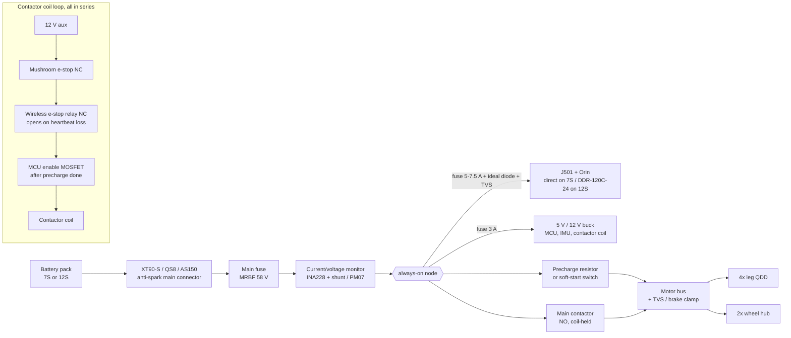
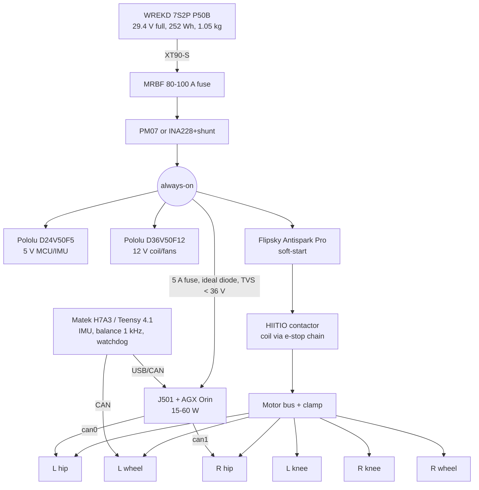
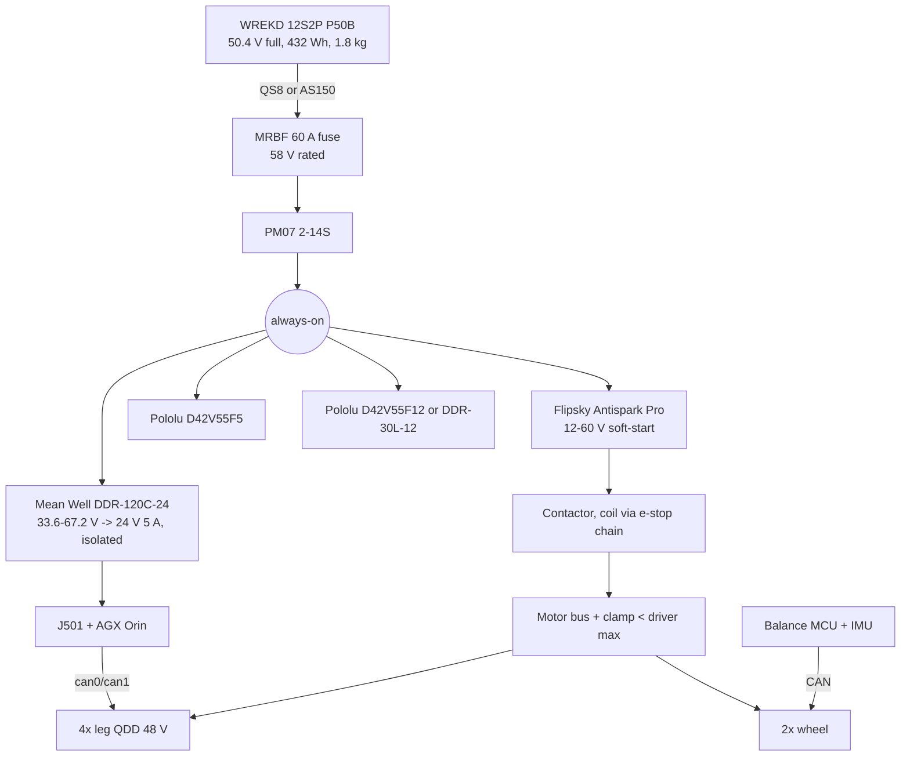

# Power and electronics for gyropup

Prices were checked on 2026-10-25. Every part named here is in
[`catalog/power_electronics.json`](../catalog/power_electronics.json), with 165 items, their sources and confidence.
"Not published" means exactly that. Numbers marked *assumption* or *example* are for illustration and must be measured on the robot.

## The short answer

- **Build the 24 V-class system (7S Li-ion) first.** The J501 runs straight off the pack with no converter in the 60 W path.
  DDT's Diablo uses the same class: its joint motors are listed at 28–32 V ([MYBOTSHOP Diablo page](https://www.mybotshop.de/Introducing-Diablo-The-Innovative-Self-Balancing-Wheeled-Leg-Robot)).
- **Move to 48 V-class (12S) only if your actuators need it.** That means 48 V-nominal motors, such as RobStride 01/02, or needing their full speed or torque.
  It costs a 48→24 V converter for the J501, a 12S charger and pricier, heavier packs.
- **The J501 talks CAN-FD natively, with two isolated ports.** You do not need a USB-CAN adapter for the motors. Keep one, the mjbots mjcanfd-usb-1x at $39, as a bench sniffer.
- **Run the balance loop on a microcontroller at 1 kHz, not on Linux.** The MCU should own the IMU and the wheel motors; the Jetson sends setpoints.
- **The hardware e-stop breaks a contactor coil, not the battery current.** Pressing it cuts motor power only, never the J501. Close the contactor only after precharge.

---

## 1. Batteries

### The J501 voltage limit decides most of this

The J501 accepts **12–36 V DC** on a 2-pin terminal block ([getting started](https://wiki.seeedstudio.com/reserver_j501_getting_started/), [datasheet](https://files.seeedstudio.com/wiki/reComputer-Jetson/J501/reServer_Industrial_J501_Carrier_Board_Datasheet.pdf)).
What counts is the **full-charge** voltage plus any regen spike, not the nominal voltage.

| Pack | Nominal | Full (4.2 V/cell) | Empty (~3.0 V/cell) | J501 direct? |
|---|---|---|---|---|
| 5S power-tool "18 V / 20 V MAX" | 18 V | ~21 V | ~15 V | Yes |
| 6S LiPo / Li-ion | 22.2 / 21.6 V | 25.2 V | ~18 V | Yes |
| 7S Li-ion | 25.2 V | 29.4 V | ~21 V | Yes, with ~6.6 V headroom for spikes |
| 8S | 28.8–29.6 V | 33.6 V | ~24 V | Yes, but only 2.4 V of headroom; needs a clamp |
| 10S (Makita XGT 40 V, Ryobi 40 V, 36 V e-bike) | 36 V | 40–42 V | ~30 V | **No**, needs a DC-DC |
| 12S | 43.2–44.4 V | 50.4 V | ~36 V | **No** |
| 13S "48 V" e-bike | 48 V | 54.6 V | ~39 V | **No** |
| DeWalt FLEXVOLT in 60 V mode (15S) | 54 V | 60 V MAX | – | **No** (it gives 5S3P in a 20 V dock) |

The empty column assumes 3.0 V/cell, the robot-side UVLO we recommend. Neither power-tool packs nor RC packs cut off on their own, so the robot must.

### Shortlist (full list in the catalog)

| Pack | V full | Wh | Cont. A | Mass | Price | Charger | Notes |
|---|---|---|---|---|---|---|---|
| **WREKD 7S2P Molicel P50B 10 Ah** | 29.4 | 252 | 120 | 1050 g | $294 | ISDT K4 $229.99 (1–8S) | **24 V-class pick.** No BMS, balance leads only; 161×48×72 mm. [link](https://wrekd.com/products/7s2p-25-2v-molicel-p50b-10000mah-li-ion-battery-pack) |
| WREKD 6S2P P50B 10 Ah | 25.2 | 216 | 120 | 900 g | $252 | ISDT K4 / ToolkitRC M6DAC Pro $129.99 | [link](https://wrekd.com/products/6s2p-21-6v-molicel-p50b-10000mah-li-ion-battery-pack) |
| WREKD 8S2P P50B 10 Ah | 33.6 | 288 | 120 | 1200 g | $336 | ISDT K4 | Too close to 36 V without a clamp. [link](https://wrekd.com/products/8s2p-28-8v-molicel-p50b-10000mah-li-ion-battery-pack) |
| CNHL 6S 10 Ah 21700 Li-ion (XT60) | 25.2 | 216 | not published | 852 g | $149.99 | as above | Cheapest Wh/$ in the 24 V class. No continuous rating published. [link](https://www.chinahobbyline.com/products/cnhl-10000mah-21-6v-6s-21700-li-ion-battery-xt60) |
| CNHL Black 6S 5000 65C LiPo (XT90) | 25.2 | 111 | 325 (claimed) | 790 g | $64.99 | as above | Cheap pack for bring-up and test-stand falls. [link](https://www.chinahobbyline.com/products/cnhl-black-series-5000mah-22-2v-6s-65c-lipo-battery-with-xt90-plug) |
| CNHL 6S 8000 30C LiPo | 25.2 | 178 | 240 (claimed) | 1300 g | $93.99 | as above | [link](https://www.chinahobbyline.com/products/cnhl-8000mah-22-2v-6s-30c-lipo-battery-with-xt90-plug) |
| **WREKD 12S2P P50B 10 Ah** | 50.4 | 432 | 120 | 1800 g | $504 | iCharger X12 $179.99 + DC PSU | **48 V-class pick.** 275×48×72 mm. [link](https://wrekd.com/products/12s2p-43-2v-molicel-p50b-10000mah-li-ion-battery-pack) |
| Tattu Plus 12S 10 Ah 15C smart LiPo | 50.4 | 444 | 150 | 2978 g | AUD only | iCharger X12 | Heavy for 444 Wh. [link](https://www.nextfpv.com/products/tattu-plus-1-0-compact-version-10000mah-44-4v-15c-12s1p-lipo-smart-battery-pack-with-as150uplug) |
| UPP U005 48 V 7 Ah e-bike bottle | 54.6 | 336 | **18** (BMS) | 1800 g | $208 | UPP 54.6 V 4 A $78 | The BMS limit is far too low for four leg motors. [link](https://www.unitpackpower.com/product/u005-36v-48v-7ah-10-5ah-mini-bottle-li-ion-ebike-battery-pack-for-250w-300w-350w-motor-with-2a-charger-%e3%80%90factory-stock%e3%80%91/) |
| Milwaukee M18 HO 12 Ah (48-11-1813) | ~21 (5S) | 216 | not published | 1529 g | $279 | M18 charger $119 | Hot-swap tool pack plus $10–16 fused docks. [link](https://thepowertoolstore.com/products/milwaukee-48-11-1813) |
| DeWalt FLEXVOLT 9 Ah (DCB609) | 60 (15S mode) | 180 | not published | 1565 g | $259 | DCB118 $149 | Heaviest Wh/kg in the list. [link](https://thepowertoolstore.com/products/dewalt-dcb609) |
| Makita XGT 40 V 5 Ah (BL4050F) | 40 | 180 | not published | not published | $309 | DC40RA $159 | 10S, so it needs a DC-DC for the J501. [link](https://thepowertoolstore.com/products/makita-bl4050f) |
| Ryobi 40 V 6 Ah (OP4060A) | 40 | 216 | not published | not published | $219 | OP406A $119 | [link](https://www.homedepot.com/p/RYOBI-40V-Lithium-Ion-6-0-Ah-High-Capacity-Battery-OP4060A/311472031) |

Wh is computed as Ah × nominal V where the vendor gave only Ah; each catalog entry marks this.

### How the three families compare

- **Power-tool packs** are good for a first walking prototype.
  - **Pros:** a latch gives hot-swap in seconds, they're tough, and chargers sell everywhere. Upkie runs on a Ryobi 18 V pack with an XT90-S lead ([Upkie BOM](https://upkie.github.io/upkie/bill-of-materials.html)).
  - **Against them:** they're heavy per Wh (M18 12 Ah: 216 Wh in 1529 g, versus 216 Wh in 900 g for the 6S2P P50B), and no continuous current is published.
  - **Voltage:** the 18–20 V class sits low for 24 V motors, which lose roughly a quarter of their top speed at 18 V. The 40/60 V classes miss the J501 limit.
  - **No cutoff:** the pack has no undervoltage cutoff; the tool provides it. The robot has to.
  - **Docks:** generic DeWalt and M18 "Power Wheels" docks with fuse and leads cost about $10. The Terrafirma M18→XT60 fused adapter is $15.80.
- **RC LiPo and Molicel Li-ion packs** give the best power-to-weight and the widest choice of voltages.
  - **No BMS:** the robot must do UVLO, per-cell monitoring is advisable, and you need a balance charger.
  - **Chemistry:** Molicel P50B packs (120 A continuous for 2P) have ~2× the energy per gram of high-C LiPo and age better. LiPo is cheaper and fine for bring-up.
  - **Swapping:** an XT90-S or QS8 on a short pigtail gives a usable hot-swap.
- **E-bike packs** have a BMS but the wrong current rating.
  - **Weak BMS:** 18–25 A continuous on the small packs, enough for one hub motor, not four QDD legs pushing out of a squat.
  - **Bulk and voltage:** bottle and downtube cases are long and awkward on a 206 mm-wide body, and 10S/13S always needs a DC-DC for the J501.
  - **Verdict:** usable only with a custom high-current BMS, so not recommended.

---

## 2. DC-DC converters

### J501 supply from a 48 V-class bus (12S/13S)

| Converter | In (V) | Out | Isolated | Eff. | Mass | Price | Comment |
|---|---|---|---|---|---|---|---|
| **Mean Well DDR-120C-24** | 33.6–67.2 | 24 V 5 A (120 W, 180 W for 3 s) | yes | 91 % | 510 g (packed) | $69.20 | **Pick.** Covers 12S/13S plus regen headroom; peak rating covers Orin bursts. [Bravo](https://www.bravoelectro.com/ddr-120c-24.html) |
| Mean Well RSD-150C-24 | 33.6–62.4 | 24 V 6.3 A | yes | 91 % | 800 g | $98.80 | Railway-rated shock/vibration (EN50155); for a robot that falls a lot. |
| Victron Orion-Tr 48/24-5A | 32–70 | 18–30 V adj, 5 A | yes | 86 % | 420 g | $58.70 | Remote on/off input. [link](https://www.portlandiaelectric.supply/products/victron-energy-ori482410110-power-supply) |
| Pololu D42V55F24 | 24–60 | 24 V ~4 A typ. at 42 V in | no | 90–95 % | 6.5 g | $49.95 | Lightest. 60 V absolute max, so on 13S it needs a regen clamp. [Pololu](https://www.pololu.com/product/5579) |
| Generic 30–90 V → 24 V 10 A potted buck (YANCINCNY C90J24V10A3S) | 30–90 | 24 V 10 A | no | 94 % (claimed) | 91 g | $23.99 | Cheap. Amazon-grade QA, so add a fuse. [Amazon](https://www.amazon.com/dp/B0FSJ7XQJP) |
| Mean Well SD-150C-24 / SD-100C-24 | 36–72 | 24 V | yes | 80–81 % | 860 / 650 g | $53.80 / $40.70 | **Avoid:** heavy, inefficient, and drops out below 36 V input (a 12S pack near empty). |

The Pololu D36V50Fx family (50 V max) cannot be used on 13S (54.6 V full), and is marginal on 12S (50.4 V) once regen is added.

### J501 on a 24 V-class bus (6S/7S)

There's no converter in the main path; the J501 runs from the pack directly. Protect that branch with these, in order:

1. A fuse sized for the J501 (60 W at 21 V is ~3 A, so a 5–7.5 A blade fuse).
2. An ideal-diode or reverse-polarity MOSFET, so a regen spike on the motor side cannot back-feed the computer.
3. A TVS clamp below 36 V across the J501 input.
4. Bulk capacitance.

A clean, isolated alternative is the **Mean Well DDR-120B-24** (16.8–33.6 V in, 24 V 5 A out, $69.20, [Bravo](https://www.bravoelectro.com/ddr-120b-24.html)). Its input window matches 7S from 2.4 to 4.8 V/cell, and its UVLO (16.8 V) helps protect the pack. Use it if you see brownouts during motor surges.

### 5 V and 12 V aux rails

| Rail | 24 V class | 48 V class |
|---|---|---|
| 5 V (MCU, IMU, CAN transceivers, LEDs) | Pololu D24V50F5, 6–38 V in, 5 A, 3 g, $32.95 ([link](https://www.pololu.com/product/2851)) or D36V50F5, 5.5 A, $39.95 | Pololu D42V55F5, 5–60 V in, 6 A, $47.95 ([link](https://www.pololu.com/product/5571)) or Mean Well DDR-30L-5, 18–75 V, isolated, $27.60 |
| 12 V (contactor coil, fans, lidar) | Pololu D36V50F12, $39.95 | Pololu D42V55F12, $47.95 ([link](https://www.pololu.com/product/5577)) or Mean Well DDR-30L-12, isolated, $27.60 ([link](https://www.bravoelectro.com/ddr-30l-12.html)) |

Matek BEC12S-Pro ($22.99, 9–55 V) and Holybro UBEC 5 A (8–60 V, $20.99) are light FPV options. The 55 V maximum is too close to 13S.

---

## 3. Power distribution and safety

### Topology



### Rules

1. **The e-stop opens the contactor coil circuit and nothing else.**
   - **Series chain:** a mushroom button (NC), the wireless receiver's relay (NC), and the MCU's "enable" switch, all in series with the coil.
   - **Fail-safe:** losing coil power opens the contactor. An anti-spark MOSFET switch is not a safety device, because MOSFETs can fail shorted.
2. **The compute stays up after an e-stop.** The J501 and the MCU sit on the always-on side, so logs and the remote link survive.
3. **Precharge before closing the contactor.** If the contactor closes onto the drivers' bulk capacitors, the inrush welds its contacts. Sequence:
   1. The MCU enables the precharge path (resistor, or the soft-start of a Flipsky/Maytech switch).
   2. The monitor sees the motor bus reach ~95 % of the pack voltage.
   3. The MCU then energises the coil.
   4. It reads the auxiliary contact (HIITIO HCZ01-250F-A) to confirm the contacts closed, and later that they opened.
4. **Clamp the motor bus.** If the contactor opens while the robot is rolling or falling, the wheel and leg motors back-drive. Their EMF charges the driver capacitors through the MOSFET body diodes, with no battery attached to absorb it. Fit a TVS or brake-resistor clamp under the drivers' maximum rating on the motor-bus side.
5. **A balancing robot falls when power is cut.** Order stops from softest to hardest:
   - **Soft stop:** the controller crouches the robot and sits it on its wheels, then disables torque.
   - **Hardware cut:** for anything worse, accept the fall. Design the body or bumpers, and the 206 × 181 × 112 mm compute box, to land on.
6. **UVLO in software.** Measure the pack voltage, warn at ~3.5 V/cell, crouch and stop at ~3.2 V/cell, and cut at 3.0 V/cell. None of the recommended packs has a BMS.

### Parts

| Function | Part | Price | Notes |
|---|---|---|---|
| Main contactor | **HIITIO HCZ01-250F-A** (250 A, 12–36 V coil, auxiliary contact, 422 g) | $44.99 | [Amazon](https://www.amazon.com/dp/B0F6C947B9). The coil range runs from 12 V aux or directly from 7S. |
| | TE Kilovac LEV100A4ANG (100 A, 12 V coil, 461 mA) | $81.91 | Brand-name sealed contactor. [findchips](https://findchips.com/search/LEV100) |
| | Littelfuse DCNLEV100, Altran ALEV100 | $66.52 / $46.70 | Alternatives. Gigavac GX12/GX14 and TE EV200 ($121–215) are oversized. |
| | JWDAWN ZJ100A (100 A, 80 V) | $18 | Unsealed, unknown QA. Bench only. |
| Soft-start / anti-spark | **Flipsky Antispark Switch Pro 200 A** (12–60 V, 14S, 100 A continuous) | $33 | [Flipsky](https://flipsky.net/products/flipsky-antispark-switch-pro-with-aluminum-pcb-case-200a-for-electric-skateboard-ebike-scooter-robots). Use it as the precharge/power switch ahead of the contactor, not as the e-stop. Flipsky's 120 A version is 12S-only. |
| | Maytech MTS2009AS (25–85 V) | $90 | |
| Main fuse | **Blue Sea 5191 MRBF terminal fuse block** (58 V, 30–300 A) | $29.93 | [Amazon](https://www.amazon.com/dp/B0019ZBTV4). The only common fuse holder in the list rated above 13S. |
| Resettable breaker | Blue Sea 7183 285-series 50 A | $59.20 | **Rated 48 V DC: fine for 7S, not for 12S/13S.** |
| Monitor | **Adafruit INA228** (85 V, 20-bit, I²C, energy/charge accumulators) | $14.95 | [Adafruit](https://www.adafruit.com/product/5832). The on-board 15 mΩ shunt is good to ~10 A (J501 branch). Use an external shunt for the main bus. |
| | Holybro PM07 (2–14S, 90 A continuous, analog V/I, 5.2 V 3 A BEC) | $43.99 | Easiest whole-bus monitor. |
| | Victron SmartShunt 500 A (BLE + VE.Direct UART) | $100.30 | Good state-of-charge display; heavier and bulkier. |
| E-stop button | IDEC XA1E-BV3U02-R (Ø16 mm, 2 NC) | $76.67 | [Digi-Key](https://www.digikey.com/en/products/detail/idec/XA1E-BV3U02-R/21450506) |
| | Schneider XB5AS8442 | $91.51 | |
| | Generic 22 mm twist-release NC | $11.99 | [Amazon](https://www.amazon.com/dp/B07R8PTTDX) |
| Wireless e-stop | FORT Robotics Wireless E-Stop (Humanistic Robotics' successor), 900 MHz up to 2 km / 2.4 GHz up to 200 m | quote only | [FORT](https://www.fortrobotics.com/wireless-emergency-stop). Safety-rated; this is the professional answer. |
| | Pololu RC switch with relay #2804 (10 A relay, behind a hobby RC receiver) | $19.95 | [Pololu](https://www.pololu.com/product/2804). Set the receiver failsafe so signal loss opens the relay. Not safety-rated. |
| | DIY ESP-NOW heartbeat (2× Seeed XIAO ESP32C3) | $9.98 | The robot opens the coil if the heartbeat is missing for 100–200 ms (*design value*). Not safety-rated. |

---

## 4. CAN

### The J501 has two native CAN-FD ports

The **reServer Industrial J501 v1.0 schematic** (sheet "DI & DO & CAN" plus the transceiver sheet) shows the details below ([schematic PDF](https://files.seeedstudio.com/wiki/reComputer-Jetson/J501/202003906_reServer_Industrial_J501_Carrier_Board_v1.0_SCH_PDF_20240529.pdf), [interfaces wiki](https://wiki.seeedstudio.com/j501_carrier_board_interfaces_usage/)).

- **Two channels, `can0` and `can1`,** on the Orin's MTTCAN controllers (kernel module `mttcan`). The wiki says they support CAN FD at 5 Mbit/s.
- **Connector J25**, a 2×10 pluggable terminal block with 3.81 mm pitch (YL032-096-020), shared with 4 DI and 4 DO. The 20-pin plug is included.

  | Pin | Signal | Pin | Signal |
  |---|---|---|---|
  | 17 | CAN0_H | 18 | CAN1_H |
  | 19 | CAN0_L | 20 | CAN1_L |
  | 14, 16 | GND_ISO | | |

- **Transceiver:** 3PEAK TPT71044-SOBR, a capacitively isolated CAN-FD part. The schematic notes it is pin-to-pin with TI ISO1042BDWR. Its isolated side is fed by a 1 W B0505S isolated DC-DC, and each line has SMCJ13CA TVS diodes. **Tie the motor-side CAN ground to GND_ISO.**
- **Termination:** 120 Ω per channel, fitted and **on by default**, switched by GPIO through a CPC1017N PhotoMOS (`CANx_120R_EN` low = on). The J501 can therefore be one end of each bus.
- **Documentation conflict:** the datasheet and the getting-started spec table say "1x CAN"; the wiki and schematic show two. Trust the schematic, and check with `ip link` on the board.
- **Setup:** the wiki example sets 125 kbit/s classic CAN. For motors use, for example, `ip link set can0 type can bitrate 1000000 dbitrate 5000000 fd on`. The `dbitrate`/`fd on` part is standard SocketCAN syntax but **not shown in Seeed's docs**, so verify it on your JetPack.

### Bus plan and load

Use one bus per side: the hip and knee QDDs plus the wheel motor, three nodes each.
- **Classic CAN at 1 Mbit/s:** a frame with 8 data bytes is ~111–135 bits, so ~7,400 frames/s at most.
- **Load:** three motors, each with a command and a reply at 1 kHz, is 6,000 frames/s, about 80 % bus load (*estimate*). That's too high.
- **Way out:** run legs at 500 Hz, or use CAN-FD data rates where the actuator supports them (Damiao's adapter is FD-capable).

### USB-CAN adapters (bench, sniffing, or a third bus)

| Adapter | FD | Linux | Isolated | Price |
|---|---|---|---|---|
| **mjbots mjcanfd-usb-1x** | yes (to 12 Mbit/s) | SocketCAN, gs_usb | no | **$39** ([link](https://mjbots.com/products/mjcanfd-usb-1x)). The fdcanusb it replaces is discontinued. |
| CANable 2.0 (Openlight Labs) | FD via slcan only (no native gs_usb FD) | slcan / serial | no | $35 ([link](https://openlightlabs.com/products/canable-2-0)) |
| PEAK PCAN-USB FD | yes | mainline `peak_usb` | yes, 500 V | $368 ([link](https://gridconnect.com/products/can-usb-fd-adapter-pcan-usb-fd)) |
| PEAK PCAN-USB (classic) | no | mainline | – | $256 |
| Damiao USB-CANFD | yes (5 Mbit/s data) | vendor tool / serial | no | $31.99 ([link](https://openelab.com/products/damiao-brushless-servo-usb-fdcan)) |
| RobStride USB-CAN debugger | no | vendor tool / serial | no | $25.09 |
| CubeMars R-Link V2.0 | no | vendor tool | no | $45.09 (needed for CubeMars firmware and setup) |
| mjbots pi3hat r4.5 | 5× FD plus an IMU | Raspberry Pi SPI (Pi 4B/3B+ only, not Pi 5) | no | $149 |

Buy the vendor's own dongle for whichever actuator brand you choose: it is the setup and firmware tool. Use the J501 ports at runtime.

---

## 5. IMU and where the balance loop runs

### What the reference robots do

- **Upkie:** a Raspberry Pi 4 Model B with an mjbots pi3hat (5 CAN-FD ports and an onboard IMU), qdd100 leg actuators and moteus wheel controllers. The default control loop is **1 kHz** on Linux with a pinned real-time thread, and a Ryobi 18 V battery powers it ([BOM](https://upkie.github.io/upkie/bill-of-materials.html), [pi3hat spine](https://github.com/upkie/upkie/blob/main/spines/pi3hat_spine.cpp)).
- **DDT Diablo:** balancing runs on the robot's internal controller. The add-on Linux computer (Raspberry Pi or Horizon X3) talks to it over UART at up to 1 kHz and sends motion commands ([diablo-sdk-docs](https://github.com/DDTRobot/diablo-sdk-docs)).
  - **Battery:** pack voltage and Wh are no longer on DDT's site.
  - **Published runtimes:** standing ≥ 90 min, low-speed walking ≥ 40 min, high-speed creeping ~4 h.
  - **Motors:** 28–32 V working, 9.6 N·m rated ([MYBOTSHOP](https://www.mybotshop.de/Introducing-Diablo-The-Innovative-Self-Balancing-Wheeled-Leg-Robot)).
- **DDT TITA:** a Jetson Orin NX with two batteries. The spec reads "0.1296 kWh … 151.2 W", which we read as 129.6 Wh each (ambiguous as published), with about 2 h runtime on both. User commands run at 30–300 Hz, and an external CAN-FD port runs at 1/5 Mbit/s ([TITA](https://robotics.directdrive.com/en/products/tita-robot/1653341764448411), [CAN interface](https://github.com/DDTRobot/Col_TITA_CAN_Inerface)).

The pattern: a hard-real-time balance controller at ~1 kHz, with the big Linux computer above it at 30–300 Hz.

### Recommendation

Run the balance loop on an MCU and let the Jetson do perception, planning and leg posture.

| Option | Cost | CAN | Comment |
|---|---|---|---|
| **Matek H7A3-SLIM flight controller** | $77.99 | 1× (JST-GH 4-pin: 5 V/CANH/CANL/GND) | **Cheapest real-time IMU + MCU.** It has an STM32H7 and an ICM-42688-P (2.8 mdps/√Hz) wired over SPI, and it's in stock. Flash custom firmware (or ArduPilot's AP_Periph-style CAN). [link](https://www.racedayquads.com/products/mateksys-h7a3-slim-flight-controller-icm42688p-30x30) |
| **Teensy 4.1** + ICM-42688-P or BMI088 on SPI | $31.50 + IMU | 3 (1 FD); needs transceivers (Adafruit CAN Pal $3.95) | Easiest to program (FlexCAN_T4), with a USB link to the Jetson. [link](https://www.sparkfun.com/teensy-4-1.html) |
| STM32G474 Nucleo | $19.50 | 3 FDCAN; needs transceivers | Most "proper" embedded route. |
| ESP32-S3 | $19.95 | 1, classic only (TWAI) | No CAN-FD. Fine at ≤1 Mbit/s classic. |
| Raspberry Pi Pico 2 | $6.25 | none native | Needs an MCP2518FD. Not recommended. |
| Jetson only, with a PREEMPT_RT kernel | $0 | J501 can0/can1 | Upkie shows Linux can hold 1 kHz with care, but a Jetson under GPU load is a riskier place for the loop that stops the robot falling over. |

Split: the MCU reads the IMU at ≥1 kHz and closes the pitch/wheel loop at 1 kHz on the wheel motors. It also runs the heartbeat watchdog, UVLO and precharge sequencing. The Jetson commands leg joints and sends velocity and height setpoints at 100–300 Hz. Two wirings work:
- the MCU on its own wheel bus, with the Jetson on can0/can1 for the legs, or
- everything on the J501 buses, with the MCU as one more node.

**IMU choice:**
- **ICM-42688-P on SPI** (on the Matek board, or a $88 breakout while supply is short). The fallback is **BMI088** (Grove board $28.15), which is more robust to vibration but noisier (14 mdps/√Hz).
- The **BNO085** ($29.50) has internal fusion, but its latency and raw-gyro rate make it a poor fit for the inner loop; it's fine for heading.
- **VectorNav VN-100 SMD dev kit** ($950, 800 Hz, 5 °/h bias) and **MicroStrain 3DM-CV7-AHRS** (quote) are only worth it for odometry or SLAM, not balancing.

---

## 6. Wiring and connectors

| Use | Connector | Rating | Price |
|---|---|---|---|
| Battery main, 24 V class | **XT90-S** (anti-spark, as on Upkie) | 90 A family | ~$2.25/pair ([Gator-RC](https://www.gator-rc.com/products/xt90-connectors-with-wire-cover-pair)) |
| Battery main, 48 V class | **QS8** (anti-spark, 300 A vendor rating, to 6 AWG) or **AS150** | 300 A / 150 A | $8.99/pair ([PRC QS8](https://www.progressiverc.com/products/qs8-connectors-1-pair)); $15.99 ([PRC AS150](https://www.progressiverc.com/products/as150-connectors)) |
| Actuator power + CAN | **Amass XT30(2+2)** / XT30PB: two power pins plus two signal pins (CAN-H/L) | 30 A power | $2.63 per lead ([example](https://openelab.com/products/xiaomi-cybergear-xt30-servo-cable-5-lengths)). Used by CubeMars AK V3 ("XT30 2+2"), Damiao DM-J4310-2EC (XT30(2+2)-F cable) and RobStride 01/02 ("XT30PB"). **Pinouts differ by brand; check before daisy-chaining mixed brands.** |
| CAN/I²C to MCU and FC | JST-GH 4-pin (Matek and Holybro CAN: 5 V / CANH / CANL / GND) | signal | silicone GH lead sets $6.99 |
| J501 power and CAN | the included 2-pin and 20-pin 3.81 mm pluggable terminals, with ferrules | – | Adafruit ferrule kit $17.95 |
| CAN cable | twisted 120 Ω pair, e.g. Belden 3105A (22 AWG, 1 pair) | – | ([Belden](https://catalog.belden.com/index.cfm?event=pd&p=PF_3105A)) |

**Wire gauge** (PowerStream rule-of-thumb chassis-wiring ampacity, [table](https://www.powerstream.com/Wire_Size.htm): 10 AWG 55 A, 12 AWG 41 A, 14 AWG 32 A, 16 AWG 22 A, 18 AWG 16 A, 20 AWG 11 A, 22 AWG 7 A):

- Size from current I = P / V. A *design value* of 1.5 kW whole-robot peak is ~60 A at 25 V, but only ~31 A at 48 V.
- **24 V class:** 10 AWG from pack to contactor and the distribution point, 12–14 AWG to each leg branch, and the 18 AWG built into the XT30 leads.
- **48 V class:** 12 AWG main and 14–16 AWG branches.
- **J501 feed:** 16–18 AWG; it draws ~3 A at 21 V.
- **CAN:** 22–26 AWG twisted pair.
- **Use silicone wire everywhere.** Wires flex at every leg joint.

---

## 7. Two architectures

### A. 24 V class: 7S Li-ion, J501 direct (recommended)



| Item | Price |
|---|---|
| 2× WREKD 7S2P P50B packs (hot-swap) | $588 |
| ISDT K4 charger | $229.99 |
| HIITIO HCZ01-250F-A contactor | $44.99 |
| Flipsky Antispark Pro | $33 |
| Blue Sea MRBF block (fuse extra) | $29.93 |
| Holybro PM07 + Adafruit INA228 | $58.94 |
| Pololu D24V50F5 + D36V50F12 | $72.90 |
| IDEC e-stop or generic e-stop | $11.99–76.67 |
| Pololu RC relay switch (with existing RC transmitter/receiver) | $19.95 |
| Matek H7A3-SLIM | $77.99 |
| XT90-S, XT30(2+2), wire, ferrules | ~$60 (*estimate*) |

Known prices only (with a generic e-stop) come to roughly **$1.2 k**, before the actuators, the J501 and the Orin.

- **Battery mass:** 1.05 kg per pack.
- **Drawback:** twice the current of 48 V for the same power, so 10 AWG runs and higher I²R losses in the motors. Check that the chosen QDDs reach the speed you need at 25 V nominal.

### B. 48 V class: 12S Li-ion, DC-DC for the J501



What changes from A:
- **Battery and charger:** the 12S pack is $504 and 1.8 kg for 432 Wh. Charging takes the iCharger X12 ($179.99) plus a DC supply, since it is DC-input, 11–53 V.
- **Converters:** the DDR-120C-24 ($69.20) for the J501, and the Pololu D42V55 family for aux rails.
- **Breakers:** the 48 V-rated Blue Sea 285 breaker can't be used.
- **Regen headroom:** 13S at 54.6 V is within 5.4 V of the 60 V maximum of most "48 V" parts, so prefer **12S**.

Pick B if the actuators are 48 V-nominal (RobStride 01/02-class) or if the robot ends up near 20 kg and wire current gets uncomfortable.

---

## 8. Runtime estimate method

```
runtime_h = (E_pack_Wh × usable_fraction × η_path) / (P_compute + P_aux + P_motors_avg)
```

- `E_pack_Wh`: nominal V × Ah from the catalog.
- `usable_fraction`: the share of nameplate energy between full and your UVLO. Take ~0.8 as a starting *assumption* at 3.0–3.2 V/cell cutoff, and measure it with the INA228 or PM07 coulomb count.
- `η_path`: 1.0 for J501 direct on 7S, ~0.91 for the J501 behind the DDR-120C-24. Motor-driver losses are inside `P_motors_avg`.
- `P_compute`: 15–60 W, the J501/Orin published range. Log it with `tegrastats` or the INA228 on the J501 branch.
- `P_motors_avg`: **not knowable from datasheets.** Measure it on the robot in each mode (standing, crouched, driving, stepping), then weight by the duty profile.
  - **Calibration points:** Diablo stands for ≥ 90 min and walks for ≥ 40 min on an unpublished pack.
  - TITA's 2 h on (we read) ~259 Wh suggests roughly 130 W average for a mid-size wheel-legged robot (*our interpretation*).

Worked example, *illustrative only*: one 7S2P pack (252 Wh) at 0.8 usable gives ~202 Wh.

| P_motors_avg (assumed) | Total with 40 W compute + 5 W aux | Runtime |
|---|---|---|
| 50 W | 95 W | ~2.1 h |
| 100 W | 145 W | ~1.4 h |
| 200 W | 245 W | ~0.8 h |

The 12S2P pack (432 Wh) gives ~1.7× these runtimes for ~0.75 kg more mass.

---

## Open items

- Confirm `can1` exists and FD works on the J501 with the shipped JetPack (`ip -details link show can0`); the docs disagree on "1x CAN".
- Choose actuators first: their bus voltage decides A or B. Check each driver's absolute maximum voltage and set the motor-bus clamp below it.
- The XT30(2+2) pinout differs by vendor. Make one labelled harness per brand.
- No catalog item has CAD yet (`cad.available` is false everywhere). Ask WREKD for pack drawings, and model the contactor and DDR-120C from their datasheets.
