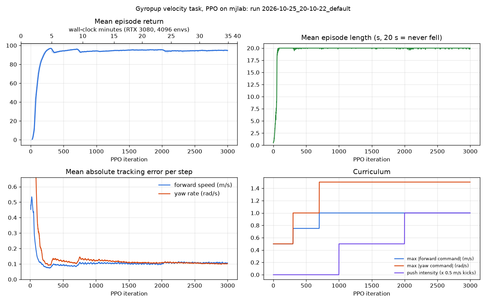
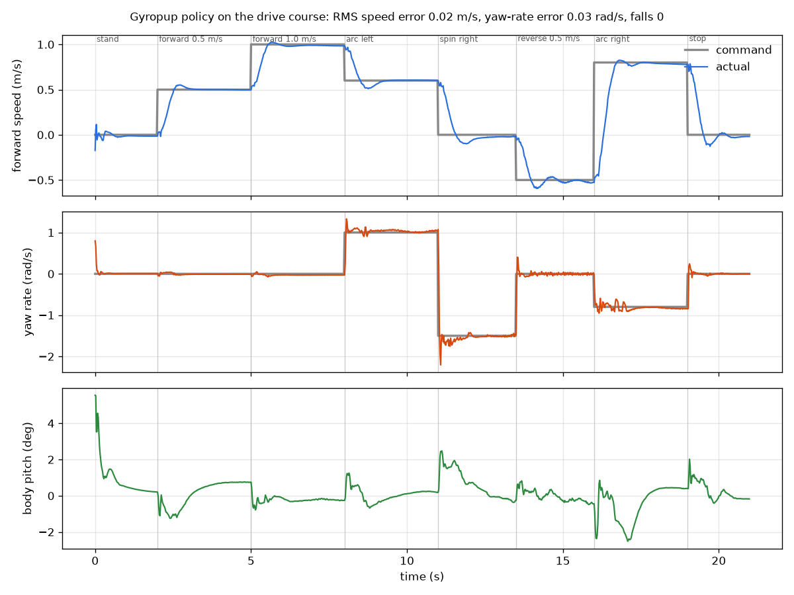

# Gyropup RL

This folder trains a neural-network balance-and-drive controller for Gyropup with reinforcement learning (PPO). It
runs thousands of simulated robots in parallel on the GPU and trains on the same robot model the CPU scenarios use.
Any design file can be trained: the model is generated from `designs/<name>.json`.

It is the "RL, step 1" path from [research/prior-art-toolchain.md](../research/prior-art-toolchain.md):
[mjlab](https://github.com/mujocolab/mjlab) (Isaac Lab's manager API on MuJoCo Warp), starting from
[mjlab_upkie](https://github.com/MarcDcls/mjlab_upkie). Upkie has exactly Gyropup's joints: hip, knee and a driven
wheel on each leg.

## Results (2026-10-25)

**It learns, it balances and it drives.** PPO on mjlab learns to balance from scratch in about 100 iterations
(1–2 minutes on the RTX 3080) and to track speed and yaw commands within about 300 iterations. The remaining
iterations harden the policy as the command range widens and pushes are added.



**Run 2**, the current policy in `results/`, was trained on `designs/default.json` as of 20:10. That is the
one-FLEXVOLT 60 V build: the model weighs 18.96 kg, the bus is 54 V, the RS-03 legs give 60 N m and 23 rad/s, and
the BotWheels give 14.3 N m and 49 rad/s. It ran 3000 iterations in 36.5 minutes: 4096 robots, 295 M env steps,
0.65–0.7 s per iteration while the desktop was in use.

| | First iteration | Last 50 iterations (full command range, pushes, all randomisation on) |
|---|---|---|
| Mean episode return | −0.8 | 94.8 |
| Episode length | 0.5 s (falls at once) | 19.98 of 20 s: falls are rare (mjlab's fell-over termination term is 0.003, against 2.3 at the start) |
| Mean speed-tracking error | — | 0.11 m/s |
| Mean yaw-rate-tracking error | — | 0.10 rad/s |

**Drive course**, nominal robot, 10 ms latency, scored after 1 s of settling in each segment:
[`scripts/play.py`](scripts/play.py) in the training simulator and [`scripts/sim2sim.py`](scripts/sim2sim.py) in
plain CPU MuJoCo with the ONNX file.



| Course segment | Command | mjlab (GPU) | CPU MuJoCo + ONNX (1 ms step, full model) |
|---|---|---|---|
| Stand | 0 m/s | −0.01 m/s | −0.01 m/s |
| Forward | 0.5 / 1.0 m/s | 0.50 / 0.99 m/s | 0.50 / 0.99 m/s |
| Arc left | 0.6 m/s, 1.0 rad/s | 0.60 m/s, 1.03 rad/s | 0.60 m/s, 1.03 rad/s |
| Spin on the spot | −1.5 rad/s | −1.51 rad/s | −1.51 rad/s |
| Reverse | −0.5 m/s | −0.51 m/s | −0.51 m/s |
| Arc right | 0.8 m/s, −0.8 rad/s | 0.79 m/s, −0.83 rad/s | 0.79 m/s, −0.83 rad/s |
| RMS error (speed / yaw rate) | | 0.018 m/s / 0.028 rad/s | 0.018 m/s / 0.026 rad/s |
| Falls, largest body pitch | | 0, 5.5° (at the start) | 0, 2.9° |

Peak torques on the course were 31 N m on the legs (the rated torque is 20 N m, the peak 60 N m) and 8 N m on the
wheels (rated 5, peak 14.3).

Videos: [`results/gyropup_drive.mp4`](results/gyropup_drive.mp4) (mjlab; the arrows show the command and the actual
velocity) and [`results/sim2sim_drive.mp4`](results/sim2sim_drive.mp4) (CPU MuJoCo with the ONNX policy). Both are
21 s at 50 fps.

**Deployment path.** `results/policy.onnx` is 194 kB: 25 inputs, 6 outputs, with the observation normaliser inside.
`results/policy.json` holds the observation layout, scales, gains and motor limits. `scripts/run_onnx.py` runs one
step with onnxruntime on the CPU. Its output matches torch to 6e-8 and a step takes 17 µs against the 20 ms
budget ([output](results/run_onnx_output.txt)). The same file drives the robot in plain CPU MuJoCo through numpy
actuator code (above).

**Robustness checks** (sim2sim, CPU MuJoCo):

| Condition | Result |
|---|---|
| 20 ms command latency (the top of the training range) | No fall; RMS 0.03 m/s, 0.03 rad/s |
| 40 ms latency (twice the training range) | No fall; RMS 0.07 m/s, 0.05 rad/s, pitch up to 4.5° |
| Run 1's policy (trained at 17.0 kg) on the 18.96 kg design | Balances and goes forward, but **cannot reverse** (−0.03 m/s for a −0.5 command) and spins at only −1.2 rad/s. **Retrain when the design changes.** |

**Run 1** (`results/run1_17kg/`) used the 17.0 kg default from earlier the same day: 4000 iterations in 39 minutes.
It reached the same quality: last-50 errors of 0.09 m/s and 0.09 rad/s, and a course RMS of 0.02 m/s and
0.03 rad/s. Two runs on two designs converging the same way shows the setup is repeatable.

**What it cannot do yet:**
- It has only seen flat ground. Slopes, kerbs and steps are untested in RL; the LQR baseline's `slope` and `curb`
  scenarios are the bar.
- It holds one height. The legs only make small balance corrections; there is no height command, crouch or jump.
- Pushes were trained only as velocity kicks of up to 0.5 m/s. Push recovery has not been scored separately.
- The motor model is the linear torque–speed line from catalog values with an estimated leg armature. There is no
  thermal limit and no identified friction. The IMU is ideal apart from uniform noise and the latency.
- It is not tested on hardware. The single ONNX step from a hand-made "standing still" observation (zero previous
  action) asks for opposite wheel speeds of a few rad/s. That is a reminder that the policy expects the observation
  history it was trained with: start it from a held stand and feed it real previous actions.

## What the task is

| | |
|---|---|
| Robot | `rl/build/<design>/robot.xml` + `model.json`, written by `sim/model.py` from the design. The floor, light and XML motors are stripped. The turret joints are removed, which welds the head at pan 0 and tilt 0 (its mass stays). |
| Start pose | `sim.controller.place_standing` at the LQR baseline's height 0.6: legs at the baseline's pose, the whole robot tilted until the centre of mass is over the axle |
| Actions, 50 Hz | 4 leg position targets (default pose + 0.5 rad × a) and 2 wheel velocity targets (20 rad/s × a) |
| Actuators | mjlab `DcMotorActuator`: a PD loop, then the linear torque–speed line (full peak torque at standstill, zero at the no-load speed at the battery voltage). Peak torque, no-load speed and armature come from `model.json`. Legs: kp = 2.5 × peak and kd = 0.06 × peak, the baseline's gains. Wheels: kp = 0 and kd = 1 N m s/rad, a velocity loop. Torque may reach the peak; heat is handled by a reward cost, not a hard limit at the rated torque. |
| Physics | MuJoCo Warp, 4 ms step, `implicitfast`, 5 steps per action |
| Actor observations (25) | IMU projected gravity (3), gyro (3), leg joint positions relative to the pose (4), all joint velocities × 0.1 (6), previous action (6), command [vx, 0, yaw rate] (3), with noise |
| Critic observations | The actor's terms without noise, plus the true base linear velocity and height (asymmetric actor-critic) |
| Commands | Forward −1…1 m/s and yaw −1.5…1.5 rad/s, resampled every 3–8 s. 10 % of robots are told to stand still. A curriculum starts at ±0.5 / ±0.5, widens at iteration 300 and is full from iteration 700. |
| Rewards | Track forward speed (2.0) and yaw rate (2.0), as in mjlab_upkie. Stay upright (1.0). Hold the standing height (0.5) and leg pose (0.3). Penalties: action rate (−0.05), mechanical power Σ\|τω\| (−1e-3), torque² (−1e-4), joint limits (−1) and falling (−50). All terms are × dt. |
| Termination | Tilt over 50°, base below 60 % of the standing height, or 20 s |
| Domain randomisation | Mass ±10 % on every link (pseudo-inertia, so the inertia scales too). Base centre of mass ±2 cm. Wheel friction 0.5–1.25. Motor strength ±10 % (the whole torque–speed line). Kp and Kd ±20 %. Command latency 0–20 ms. Encoder bias ±0.01 rad. Pushes of up to ±0.5 m/s, phased in from iteration 1000. |
| PPO | RSL-RL 5.4. Actor and critic MLPs 256-128-64 (ELU) with observation normalisation. 4096 envs × 24 steps per iteration. Adaptive learning rate. |

Files:

| File | What it does |
|---|---|
| [`gyropup_rl/robot.py`](gyropup_rl/robot.py) | Design → model (runs `sim/model.py` in the main venv), standing pose, mjlab entity and DcMotor actuators |
| [`gyropup_rl/velocity_env_cfg.py`](gyropup_rl/velocity_env_cfg.py) | The task: observations, actions, commands, rewards, randomisation, curriculum, PPO settings |
| [`gyropup_rl/tasks.py`](gyropup_rl/tasks.py) | Registers `Gyropup-Velocity` with mjlab. The runner saves an ONNX copy next to every checkpoint. |
| [`train.py`](train.py) | `--design designs/<name>.json` + any mjlab `train` option |
| [`scripts/play.py`](scripts/play.py) | Scripted drive course in the training simulator → MP4, tracking plot, metrics |
| [`scripts/plot_training.py`](scripts/plot_training.py) | TensorBoard log → `results/training_curves.png` + `training_summary.json` |
| [`scripts/export_onnx.py`](scripts/export_onnx.py) | Checkpoint → `results/policy.onnx` + `policy.json` (observation layout, scales, gains, motor limits, a reference input/output pair) |
| [`scripts/run_onnx.py`](scripts/run_onnx.py) | One control step with onnxruntime on the CPU, a check against the torch reference, and the latency |
| [`scripts/sim2sim.py`](scripts/sim2sim.py) | The ONNX policy in plain CPU MuJoCo on the full `robot.xml` (1 ms step, turret joints present), with numpy actuator code |

## Install

The RL tools have their own venv, so the main `.venv` (CadQuery, MuJoCo 3.17) is untouched. mjlab needs Linux, an
NVIDIA GPU (Turing or newer) and driver 580 or newer; this machine has an RTX 3080 12 GB, driver 580.178 and CUDA 13.0.

```bash
cd rl
uv venv --python 3.12 .venv
VIRTUAL_ENV=.venv uv pip install mjlab onnxruntime matplotlib
# got: mjlab 1.6.0, mujoco + mujoco-warp 3.11.0, warp-lang 1.18.0, torch 2.14.1+cu130, rsl-rl-lib 5.4.2, onnxruntime 1.31.0
```

The main venv is still needed: `robot.py` calls it to generate the model (CadQuery and the designer's node model).

## Train, play, export

```bash
cd rl
# train (0.4-0.7 s per iteration with 4096 envs on the RTX 3080 depending on desktop load; 36 min for 3000 iterations)
.venv/bin/python train.py --design designs/default.json --env.scene.num-envs 4096 --agent.max-iterations 3000
# any other design: its model is rebuilt into rl/build/<name>/ if the design file is newer
.venv/bin/python train.py --design designs/mini-ddsm115.json --env.scene.num-envs 4096
# watch the curves
.venv/bin/tensorboard --logdir logs/rsl_rl/gyropup_velocity
# after training (each script uses the newest checkpoint unless --checkpoint is given)
.venv/bin/python scripts/plot_training.py
MUJOCO_GL=egl .venv/bin/python scripts/play.py --design designs/default.json
.venv/bin/python scripts/export_onnx.py --design designs/default.json
.venv/bin/python scripts/run_onnx.py
MUJOCO_GL=egl .venv/bin/python scripts/sim2sim.py --video
MUJOCO_GL=egl .venv/bin/python scripts/sim2sim.py --tag delay40ms --delay-ms 40
```

Checkpoints and TensorBoard logs go to `logs/rsl_rl/gyropup_velocity/<date>_<design>/` (gitignored). Resume with
`--agent.resume True --agent.load-run <run dir name>`. `--help` lists every option; any field of the env or agent
config can be overridden from the command line, e.g. `--agent.algorithm.learning-rate 5e-4`.

A policy belongs to the design it was trained on. If the design's masses, legs or motors change, retrain: run 1's
policy could not reverse on the 11 % heavier design. The model is rebuilt whenever the design, `sim/model.py` or
`tools/derive.mjs` is newer than `rl/build/<design>/robot.xml`. The exact model each result was trained on is
frozen in `results/trained_model/` (`robot.xml`, `model.json`, `design.json`). To replay or export on that model
after the design has moved on:

```bash
GYROPUP_MODEL_DIR=results/trained_model MUJOCO_GL=egl .venv/bin/python scripts/play.py
```

## Credits and licences

- **mjlab** ([mujocolab/mjlab](https://github.com/mujocolab/mjlab), Apache-2.0) provides the environment framework,
  MuJoCo Warp simulation, DcMotor actuator, randomisation terms and the RSL-RL runner. It is installed from PyPI, not
  vendored.
- **mjlab_upkie** ([MarcDcls/mjlab_upkie](https://github.com/MarcDcls/mjlab_upkie), Apache-2.0, © 2025 Marc
  Duclusaud) is vendored for reference in `vendor/mjlab_upkie/` at commit `d7895789a601943f78b3b9bcdc4def7b444f9913`
  (2026-05-26), with its LICENSE; see [vendor/README.md](vendor/README.md). Gyropup's velocity task follows its
  structure: actions, tracking/upright/pose rewards and the command and push curricula. No Upkie code is imported at
  run time. The vendored copy includes Upkie's STL meshes and pretrained checkpoint (about 16 MB); delete
  `vendor/mjlab_upkie/` before committing if you only want the link.
- **RSL-RL** (ETH Zurich, BSD-3) provides PPO. **MuJoCo / MuJoCo Warp** (Google DeepMind, Apache-2.0) provide the
  physics.

## Next steps

1. **Rough terrain curriculum.** Switch the terrain to mjlab's generator (`ROUGH_TERRAINS_CFG` with
   `terrain_levels_vel`) and add slopes up to 10°, 25 mm kerbs and steps. This matches the CPU scenarios `slope`
   and `curb`. Add a height scan to the critic only.
2. **Push recovery.** Raise the push curriculum beyond 0.5 m/s, add force pushes at the head height
   (`apply_body_impulse`), and score with `sim/scenarios.py push` through `sim2sim.py`.
3. **Height command and jumping.** Add a height command (crouch to stand), then a jump task with phase rewards. The
   recipe is Wheel-Legged-Lab's (Apache-2.0): 0.09–0.12 m hops and 7 cm obstacles.
4. **Closer to the hardware.** Use measured actuator data (`mujoco.sysid`) and MuJoCo's `<dcmotor>` with thermal
   state for the squat-endurance limit. Model IMU delay and filtering, and train with the VN-100's noise figures.
5. **Isaac Lab 3.0 port.** It has the same manager API on the Newton/MuJoCo-Warp backend. Port when Isaac Sim
   rendering, sensors or ROS are needed (Isaac Sim 6.2 is required; 6.0 is installed).
6. **Deployment.** Convert `policy.onnx` with TensorRT (`trtexec --onnx=policy.onnx`) on the Jetson AGX Orin and run
   it at 50 Hz. The 1 kHz microcontroller balance loop stays as the safety layer. The PD and torque–speed law in
   `policy.json` moves to the motor drivers.
